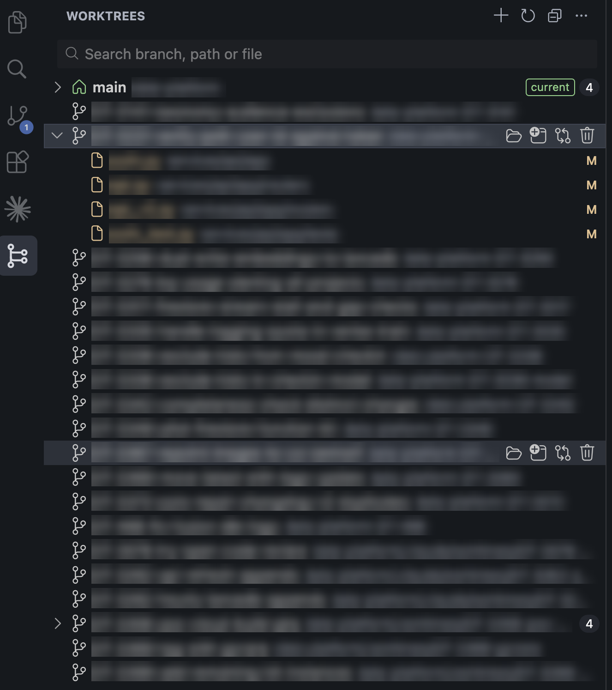

# TreeDeck: Git Worktree Manager for VS Code and Cursor

[](https://github.com/luthfidhani/treedeck/actions/workflows/release.yml)
[](https://github.com/luthfidhani/treedeck/releases/latest)
[](LICENSE)

**TreeDeck** is a lightweight, free VS Code and Cursor extension for managing **git worktrees**. One sidebar
panel lists every worktree of your repository, shows the changed files and diffs in each one, and lets you
open, create, remove, prune or compare worktrees without leaving the editor.

It is built for working on several branches at once, for example reviewing a pull request while a feature
is half done, or running **parallel AI coding agents** (Cursor agents, Claude Code) that each get their
own worktree.

- Every worktree at a glance: branch, path, number of changed files, ahead/behind upstream.
- Click a changed file to open a HEAD ↔ working tree diff for that worktree.
- Live search across branch names, paths and changed file names.
- No runtime dependencies. It runs the `git` on your PATH.
- No telemetry and no network calls.
- Works in VS Code 1.85+, Cursor, and other VS Code-based editors.

<p align="center"></p>

## Install

1. Download `treedeck-<version>.vsix` from the [latest release](https://github.com/luthfidhani/treedeck/releases/latest).
2. In Cursor or VS Code, open the Command Palette and run **Extensions: Install from VSIX…**, then pick the file.
   From a terminal: `cursor --install-extension treedeck-<version>.vsix` or `code --install-extension treedeck-<version>.vsix`.
3. Click the **TreeDeck** icon in the activity bar.

## Features

**Worktrees panel.** Each worktree shows its branch (or short SHA when detached, or `(bare)`), a short path,
the number of changed files, and ahead/behind counts against its upstream. The worktree open in this
window is tagged `current`. Icons tell apart the main checkout, linked worktrees, detached, locked,
prunable (folder missing) and agent worktrees. Hover a worktree for its full path, branch, HEAD and lock reason.

**Open.** Hover a worktree for its buttons: open in this window, open in a new window, compare with base,
and remove. Right-click for Copy Path and Reveal in File Explorer.

**Changed files and diffs.** Click a worktree to expand it and see its changed files, colored like the built-in Git view.
Click a file to open a HEAD ↔ working tree diff for that worktree. Added, untracked, deleted and renamed
files are handled.

**Manage.**

- **Create Worktree** (`+` in the view title): pick an existing local or remote branch, or create a new one
  from a base branch. The folder defaults to `../{repo}-{branch}`.
- **Remove Worktree** (trash button on hover, or right-click): always asks for confirmation first. It warns when the worktree has uncommitted or
  untracked files (offers Force Remove) and unlocks locked worktrees. It never removes the main checkout or
  the worktree open in this window.
- **Prune Stale Worktrees** (view `…` menu): shows a dry-run preview before pruning.

**Compare.**

- **Compare with Base Branch** (right-click): files changed on the branch since it forked from base
  (`git diff base...HEAD`). Pick a file to open its diff; the list stays open so you can step through files.
- **Compare Two Worktrees** (view `…` menu): files that differ between two worktrees' HEADs.

**Status bar.** Shows `repo · branch`. Click it to switch worktree through a fuzzy QuickPick.

**Search and sort.** The search box at the top of the panel filters live by branch, path or changed file
name. Arrow keys move through the list. Ordering comes from the `treedeck.sortBy` setting.

**Multi-root.** Each repo gets its own group. Several folders from the same repo are merged into one group.

## FAQ

### How do I manage git worktrees in VS Code or Cursor?

Install TreeDeck and open the **TreeDeck** icon in the activity bar. It lists every `git worktree` of the
open repository. Use `+` to create a worktree from an existing or new branch, and hover a worktree for
buttons to open it, open it in a new window, compare it with the base branch, or remove it.

### How do I see uncommitted changes in all my worktrees at once?

Each worktree in the panel shows how many files have changed. Click a worktree to list its changed files,
and click a file to open its diff. You don't have to open the worktree first.

### How do I switch between git worktrees quickly?

Click `repo · branch` in the status bar, or run **TreeDeck: Switch Worktree…** from the Command Palette, and
type part of the branch name or path.

### Does it work with Cursor agent and Claude Code worktrees?

Yes. They are ordinary git worktrees, so they appear in the list. Worktrees under `.cursor/worktrees` are
tagged `agent` by default. To tag other locations, for example Claude Code's `.claude/worktrees`, add a glob
to `treedeck.agentWorktreeGlobs`.

### How is TreeDeck different from GitLens?

GitLens is a large extension that covers many git features, worktrees among them. TreeDeck does only
worktrees. It has no dependencies, no account and no telemetry, and the extension is about 100 KB.

### How do I clean up stale or deleted worktrees?

Worktrees whose folder is gone are marked `missing`. Run **Prune Stale Worktrees…** from the panel's `…`
menu. It shows a dry-run preview (`git worktree prune --dry-run`) before it deletes anything.

## Settings

| Setting | Default | |
|---|---|---|
| `treedeck.defaultOpenBehavior` | `sameWindow` | What **Open Worktree** and the status bar switcher do: `sameWindow` or `newWindow` |
| `treedeck.baseBranch` | `""` | Base for Compare with Base Branch. Empty means auto-detect: `main`, then `master`, then `origin/HEAD` |
| `treedeck.newWorktreePathPattern` | `../{repo}-{branch}` | Default folder for new worktrees, relative to the main checkout |
| `treedeck.agentWorktreeGlobs` | `["**/.cursor/worktrees/**"]` | Paths tagged as agent worktrees (Cursor parallel agents) |
| `treedeck.postCreate.copyFiles` | `[]` | Files copied from the main checkout into a new worktree, e.g. `[".env"]` |
| `treedeck.postCreate.command` | `""` | Command run in a terminal inside a new worktree, e.g. `npm install` |
| `treedeck.sortBy` | `currentFirst` | `currentFirst`, `name` or `recent` |
| `treedeck.gitPath` | `git` | Path to the git executable |

## Requirements

git 2.7 or newer. git 2.31+ is recommended because it reports prunable worktrees and lock reasons.

## Develop

```sh
npm install
npm run build      # esbuild → dist/extension.js
npm run lint       # tsc + eslint + prettier --check
npm test           # vitest: parser tests plus one test against real git in a temp repo
```

Press **F5** in VS Code or Cursor to start an Extension Development Host.

## Build and install the .vsix

```sh
npm run package    # → treedeck-0.1.0.vsix
```

- **Cursor:** open the Command Palette, run **Extensions: Install from VSIX…** and pick the file.
  From a terminal: `cursor --install-extension treedeck-0.1.0.vsix`.
- **VS Code:** same command, or `code --install-extension treedeck-0.1.0.vsix`.

## Release

GitHub Actions does all of it:

- **Pull requests** ([`ci.yml`](.github/workflows/ci.yml)): every opened PR and every new commit pushed to it
  runs lint, tests and packaging. The `.vsix` is attached to the run as an artifact.
- **Merges to `main`** ([`release.yml`](.github/workflows/release.yml)): runs the same CI. If it passes and the
  version in `package.json` has no release yet, it tags `v<version>` on that commit and publishes a GitHub
  Release with the `.vsix`.

To release, bump the version in a PR and merge it:

```sh
npm version patch --no-git-tag-version   # or minor / major
```

Merges that don't change the version only run CI.

All actions are pinned to full commit SHAs. npm dependencies install with `npm ci --ignore-scripts`, which uses
exactly the versions and sha512 integrity hashes in `package-lock.json`.

## Publish to the marketplaces

Before publishing, set `publisher` in `package.json` to your real publisher ID.

- **VS Code Marketplace:** create a publisher at <https://marketplace.visualstudio.com/manage> and an Azure
  DevOps PAT with the *Marketplace → Manage* scope. Then run `npx vsce login <publisher>` and `npx vsce publish`.
- **Open VSX** (the registry Cursor, VSCodium and others install from): sign in at <https://open-vsx.org>,
  create an access token and claim the namespace once with `npx ovsx create-namespace <publisher> -p <token>`.
  Then run `npx ovsx publish treedeck-0.1.0.vsix -p <token>`.

## License

MIT
